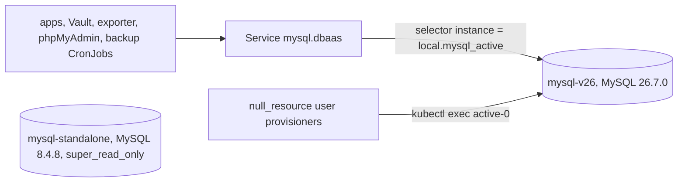

# MySQL major upgrade (blue-green) and rollback

Last updated: 2026-10-19 (rollback copy scaled to 0 after a restore test of the nightly 26.7 dump)

The shared MySQL in `dbaas` moved from the 8.4 LTS to the 26.7 innovation
release by building a second instance next to the first and switching the
`mysql` Service over, rather than upgrading in place. The 8.4.8 instance stays
as a read-only copy, so a rollback is a one-line change. Since 2026-10-19 that
copy runs at 0 replicas with its PVC kept, so a rollback first starts it
again.

## Why not in place

Oracle's upgrade-path table (MySQL 9.7 manual, section 3.2) lists in-place
upgrades within a series, from an LTS to the next LTS (8.4 to 9.7), and from an
LTS to an innovation release before the next LTS. Going from 8.4 to 26.x skips
the 9.7 LTS, which needs two steps (8.4 to 9.7, then 9.7 to 26.x). The
downgrade table lists no in-place path out of an innovation release: going back
means a logical dump and load, and only if no new server feature has touched
the data. A blue-green copy avoids both limits, and the old instance is the
rollback.

Release notes that mattered for this move:

- `mysql_native_password` was removed in 9.0. Every account here already used
  `caching_sha2_password`, but the server option `mysql-native-password=ON` in
  the old config file would stop a 9.x or 26.x server from starting, so the new
  config map is the old file minus that line.
- 26.7.0 has no item marked "Incompatible Change". It adopts calendar
  versioning (YY.M.P) after the 9.7 LTS series.

## Layout after the 2026-10-15 cutover

| Piece | Value |
|---|---|
| Active instance | StatefulSet `mysql-v26`, image `docker.io/library/mysql:26.7.0`, PVC `data-mysql-v26-0` (30Gi, `proxmox-lvm-encrypted`, autoresizer limit 60Gi) |
| Rollback copy | StatefulSet `mysql-standalone`, `mysql:8.4.8`, PVC `data-mysql-standalone-0` (30Gi), `super_read_only=ON` and `read_only=ON` set with `SET PERSIST` (stored in its datadir, so a restart keeps them), data as of 23:11 UTC on 2026-10-15. At 0 replicas since 2026-10-19; Renovate holds its image pin |
| The switch | `local.mysql_active` in `stacks/dbaas/modules/dbaas/main.tf` |
| What follows the switch | the `mysql` Service, so every app, Vault's database secrets engine, `mysqld-exporter`, phpMyAdmin and both backup CronJobs (host `mysql.dbaas`); the `mysql_static_user`, `mysql_exporter_user` and `mysql_verify_probe_user` provisioners (they exec into `<active>-0`) |
| Direct addresses | `mysql-v26.dbaas.svc.cluster.local` (new). `mysql-standalone` and `mysql-standalone-headless` are Services left over from the Bitnami chart and select the old pod. On 2026-10-16 only `mysql-standalone-headless` had an endpoint (the `mysql-standalone` EndpointSlice was empty and connections were refused), so reach the old server through `mysql-standalone-headless.dbaas.svc.cluster.local` |
| Config | config map `mysql-v26-cnf`, derived from `mysql-standalone-cnf` with `replace()`, so a tuning change to the old file reaches both |
| Backup clients | `mysql-backup` and `mysql-backup-per-db` run `docker.io/library/mysql:26.7.0` (were `mysql:8.0`) |

## Rollback to 8.4.8

Writes made on 26.7 after the cutover are not on the 8.4.8 copy. If they
matter, copy the changed tables back first (`mysqldump` from `mysql-v26-0` with
the 8.4.8 client, which the old pod has; check FLOAT columns as described under
"Gotchas").

0. Start the rollback copy: set `replicas = 1` on
   `kubernetes_stateful_set_v1.mysql_standalone`, commit, push, apply
   `stacks/dbaas` from the main checkout, and wait for `mysql-standalone-0` to
   be Ready (`kubectl -n dbaas rollout status statefulset mysql-standalone`).
   It reattaches `data-mysql-standalone-0` and starts read-only. Then scale
   Grafana to 0 (see "Write freezes: stop Grafana first" below).
1. Make the new instance read-only so nothing writes to both:
   `kubectl -n dbaas exec mysql-v26-0 -c mysql -- bash -c 'mysql -uroot -p"$MYSQL_ROOT_PASSWORD" -e "SET PERSIST super_read_only=ON"'`.
2. Open the old one:
   `kubectl -n dbaas exec mysql-standalone-0 -c mysql -- bash -c 'mysql -uroot -p"$MYSQL_ROOT_PASSWORD" -e "SET PERSIST super_read_only=OFF; SET PERSIST read_only=OFF"'`.
3. In `stacks/dbaas/modules/dbaas/main.tf` set `local.mysql_active` back to
   `"mysql-standalone"`. The backup CronJobs can stay on the 26.7.0 client
   (a newer `mysqldump` reads an 8.4 server). Commit, push, then apply from the
   main checkout: `cd stacks/dbaas && ../../scripts/tg apply --non-interactive`
   (tier-0 stack, local state, so it does not depend on MySQL or Postgres).
4. Kill client sessions on `mysql-v26-0` so pooled connections (Forgejo,
   Grafana, Uptime Kuma, Vault) reconnect through the Service:
   `SELECT id FROM information_schema.processlist WHERE user NOT IN ('event_scheduler','system user')`
   and `KILL` each id except your own.
5. Check: `kubectl -n dbaas get endpointslices -l kubernetes.io/service-name=mysql`
   shows the old pod IP, `SELECT @@super_read_only` is 0 on `mysql-standalone-0`,
   and the checks under "Proving it" pass.
6. Scale Grafana back to 1 and check its `/api/health`.
7. Point the `MysqlStandaloneDown` and `MySQLNotServing` alerts
   (`stacks/monitoring/modules/monitoring/prometheus_chart_values.tpl`) and
   `MYSQL_IMAGE` plus the workload name in `stacks/dbaas/verify.sh` back at
   `mysql-standalone` / `mysql:8.4.8`.

## How the copy was made

1. Per-database dump of all 20 schemas with the 8.4.8 `mysqldump` inside the
   old pod (`--single-transaction --quick --routines --events --triggers
   --hex-blob --set-gtid-purged=OFF`), gzip, written to
   `/mnt/backup/manual-upgrade-20261015/mysql/` on 192.168.1.127, plus
   `users-pre.sql` (`SHOW CREATE USER` with `print_identified_with_as_hex=ON`,
   and `SHOW GRANTS`, for the 16 non-system accounts). Each file passed
   `gzip -t` and ends with `-- Dump completed`. The schemas hold no routines,
   events, triggers or views, and every table is InnoDB.
2. Initial load into `mysql-v26` with the redo log disabled
   (`ALTER INSTANCE DISABLE INNODB REDO_LOG`): 345 s in three lanes
   (nextcloud 345 s, wrongmove 182 s, the rest under 60 s).
3. Users and grants applied from the export as `DROP USER IF EXISTS` plus
   `CREATE USER ... AS <hash>`, so every password is unchanged.
4. Pre-sync while the old instance was still live: every table whose
   `UPDATE_TIME` was after the dump started, or was NULL, copied again (381 s),
   then the FLOAT fix below, then `CHECKSUM TABLE` on all 659 tables on both
   sides. 642 matched; the 17 that did not were all tables written after the
   pre-sync started.
5. Write freeze: `SET GLOBAL super_read_only=ON` on the old instance at
   22:53:32 UTC. Final delta: tables with `UPDATE_TIME` (read with
   `information_schema_stats_expiry=0`) or `CREATE_TIME` after the pre-sync
   start, or NULL (544 tables, about 2 GB, mostly `nextcloud.oc_filecache`),
   then the FLOAT fix, then `CHECKSUM TABLE` on those 544 on both sides: 0
   mismatches. Users and grants were copied again inside the window, so a
   Vault rotation between the dump and the freeze could not be lost.
6. `ALTER INSTANCE ENABLE INNODB REDO_LOG`, then the flip (targeted apply of
   `module.dbaas.kubernetes_service.mysql`) at 23:11:01, then `KILL` of every
   client session on the old instance and `SET PERSIST super_read_only=ON`
   there. A full `dbaas` apply afterwards re-ran the user provisioners against
   `mysql-v26-0` and moved the backup CronJobs to the 26.7.0 client.

The write window ran from 22:53:32 to 23:11:01 UTC (17.5 minutes). About 10
minutes of it went to a retry: the first nextcloud delta copy failed (see
"Gotchas") and the first attempt to rerun it in the background inside the pod
never started. With the copy run inside the pod from the start, the window
would have been about 7 minutes.

## Gotchas found on the way

- `mysqldump` loses precision on FLOAT columns. The server sends FLOAT over
  the text protocol with about 6 significant digits, so 40.794979095458984 is
  dumped as 40.795 and restores as 40.79499816894531. DOUBLE and DECIMAL
  round-trip exactly. The nightly dumps have the same limitation. Affected
  here: `wrongmove.buylisting`, `rentlisting`, `dailylistingaggregate`,
  `destination`, `listingdecision`; `uptimekuma.stat_daily`, `stat_hourly`,
  `stat_minutely`; `speedtest.results`; `finance.position`, `transaction`;
  `grafana.test_data`. The copy fixed them by reading each FLOAT column by
  primary key as `CAST(col AS DOUBLE)` from the old server, loading that into a
  temporary table on the new one and running `UPDATE ... JOIN`. For
  `wrongmove.rentlisting` (142k rows, about 21 KB each) that UPDATE took about
  20 minutes, because InnoDB reads the whole row, off-page JSON included.
- `CHECKSUM TABLE` results are comparable between 8.4.8 and 26.7.0 for
  identical data (619 untouched tables matched on the first comparison). The
  only mismatches on untouched tables came from the FLOAT rounding above.
- Large uncompressed streams through `kubectl exec` were cut short twice
  (`gzip: stdin: unexpected end of file` on the receiving side while the
  sending `kubectl exec` still exited 0; a `Websocket Ping failed` warning
  once). Compressing both ends turned the damage into a loud failure. The
  reliable fix was to run `mysqldump -h <old pod IP> | mysql` inside the new
  pod, so the data crosses the pod network and only status text crosses
  `kubectl exec`.
- `setsid nohup ... &` at the end of a `kubectl exec ... bash -c` list does not
  survive: the backgrounded list gets `/dev/null` as stdin and is gone when the
  exec session ends. Run long copies in the foreground.
- `information_schema.tables.UPDATE_TIME` is cached for a day unless the
  session sets `information_schema_stats_expiry=0`, and it is NULL for tables
  evicted from the dictionary cache, so NULL has to count as changed.
- Forgejo keeps its data in this MySQL. A `git push` needs it writable, so the
  flip commit has to be pushed before the freeze. Pushing a `state(dbaas)`
  commit (no `[ci skip]`) makes Woodpecker run a `dbaas` apply, which is a
  no-op as long as master matches what was applied.
- `SHOW FULL PROCESSLIST` text through `information_schema.processlist`
  fails with `Cannot convert string ... from utf8mb4 to utf8mb3` when a running
  INSERT holds an emoji; wrap `info` in `CONVERT(info USING utf8mb4)`.

## Proving it (2026-10-15)

- `mysql-v26` serves `26.7.0`; `mysqld_exporter` reports `mysql_up=1` and
  `version=26.7.0`.
- Nextcloud `status.php` answers `installed:true, maintenance:false,
  needsDbUpgrade:false`; `occ status` is clean; an `occ config:app:set`
  round trip wrote and deleted a row.
- Forgejo `/api/healthz` passes its `database:ping`; a push landed and the
  Woodpecker webhook (hook 21) delivered (`hook_task` rows 8540 and 8541
  succeeded); pipeline 2549 ran green.
- Uptime Kuma writes heartbeats into the new database and logged no database
  error after the flip.
- phpIPAM import wrote 113 address rows at 23:14 UTC. The job itself ends
  failed because the `mladost3` source cannot SSH to 192.168.3.1 (publickey),
  which started before the freeze and is not related to MySQL.
- Grafana `/api/health` reports `database: ok`; Vault's `database/reset/mysql`
  reconnected to the new instance.
- `scripts/verify/run dbaas`: the MySQL scratch write, read-back and drop pass
  against 26.7.0, and the backup CronJobs ran on the 26.7.0 client.

## Restore test of the nightly 26.7 dump (2026-10-19)

The design's condition for stopping the rollback copy was a restore test of
the nightly 26.7 mysqldump. The full dump from 2026-10-19 00:30 UTC
(`/srv/nfs/mysql-backup/dump_2026_10_19_00_30.sql.gz`, 717,161,278 bytes,
`mysqldump --all-databases` on the 26.7.0 client) was copied into a throwaway
Job in `dbaas` (`mysql:26.7.0`, the `mysql-v26-cnf` config, emptyDir, NFS
backup PVC mounted read-only) and loaded with `mysql --force` into a freshly
initialised server:

- The load took 13.5 minutes and printed no error.
- 24 schemas, 659 tables and 22 accounts in `mysql.user` on both the restore
  and the live `mysql-v26`. The table count matched in each of the 17 schemas
  that hold tables.
- The five largest tables of each schema (82 tables) were counted with
  `count(*)` on both sides, 17 hours after the dump. 59 matched exactly, 17
  had fewer rows in the dump and 6 more, all consistent with the writes and
  retention pruning since the dump (largest: `nextcloud.oc_activity` 2,911,987
  restored against 2,911,966 live, `nextcloud.oc_calendarchanges` 2,132,454
  against 2,136,750; `uptimekuma.heartbeat` and `freshrss.viktor_entry` are
  pruned by their apps, so the dump holds more rows than live).
- FLOAT columns are rounded by `mysqldump` (see "Gotchas"); a row count does
  not detect that.

## Write freezes: stop Grafana first

Grafana keeps its own state (sessions, alerting, annotations) in the
`grafana` schema and writes to it all the time. During the 2026-10-15 freeze
(`super_read_only=ON` from 22:53:32 to 23:11:01 UTC) it crash-looped, with
about 8 container restarts. Stop it for the length of any MySQL write freeze,
including step 1 of the rollback above:

1. Before setting `super_read_only=ON`:
   `kubectl -n monitoring scale deployment grafana --replicas=0`, then wait for
   the pod to go: `kubectl -n monitoring wait --for=delete pod -l app.kubernetes.io/name=grafana --timeout=120s`.
2. Run the freeze and the flip.
3. Once the active instance takes writes again (`SELECT @@super_read_only`
   is 0 on it and the `mysql` Service points at it):
   `kubectl -n monitoring scale deployment grafana --replicas=1`, then
   `kubectl -n monitoring rollout status deployment grafana`, and check
   `kubectl -n monitoring exec deploy/grafana -c grafana -- wget -qO- http://localhost:3000/api/health`
   reports `"database": "ok"` (the public URL sits behind Authentik and
   answers 302).

The scale is a transient step: the replica count lives in
`stacks/monitoring/modules/monitoring/grafana_chart_values.yaml`
(`replicas: 1`), and the next `monitoring` apply restores it if step 3 is
missed. Dashboards are unavailable while it is down; alerting runs in
Prometheus and Alertmanager and is not affected.

## Next upgrade

Innovation releases upgrade in place within their series and to the next LTS,
and cannot be downgraded in place. For each bump take a fresh per-database
dump first (the `mysql-backup-per-db` CronJob, or step 1 above), then change
the image pin on `mysql-v26`. For a jump Oracle does not list as in place,
repeat this blue-green procedure with a new StatefulSet and flip
`local.mysql_active`. Renovate holds MySQL majors (`renovate.json5`).

## Open items

- `mysql-standalone` runs at 0 replicas since 2026-10-19; it and its PVC
  `data-mysql-standalone-0` are kept until Viktor decides to delete them. Its
  image stays on 8.4.8; do not bump it (a Renovate rule holds the pin).
- The off-cluster dump lives in `/mnt/backup/manual-upgrade-20261015/mysql/`
  on 192.168.1.127. The first copy, taken before the cutover, was deleted by
  the nfs-mirror run that finished at 23:28 UTC on 2026-10-15, because
  `nfs-mirror` had no exclude for that directory. `scripts/nfs-mirror.sh` now
  excludes `/manual-upgrade-*/`. The set there now was re-taken on 2026-10-16
  from the read-only 8.4.8 server (`super_read_only=1`, so it holds the data as
  of the 23:11 UTC cutover) with the 8.4.8 client: one `<db>.sql.gz` per
  schema, `users.sql` (`SHOW CREATE USER` in hex plus `SHOW GRANTS`, 18
  accounts), `users-pre-worker-20261015.sql` (the original pre-cutover users
  file), `table-inventory.tsv` and `SHA256SUMS`. It was checked by restoring
  every file into a scratch 8.4.8 server: 659 tables and 8,178,205 rows, the
  same totals as the source. FLOAT columns are rounded by `mysqldump`; the
  exact values remain on the old server's PVC.
