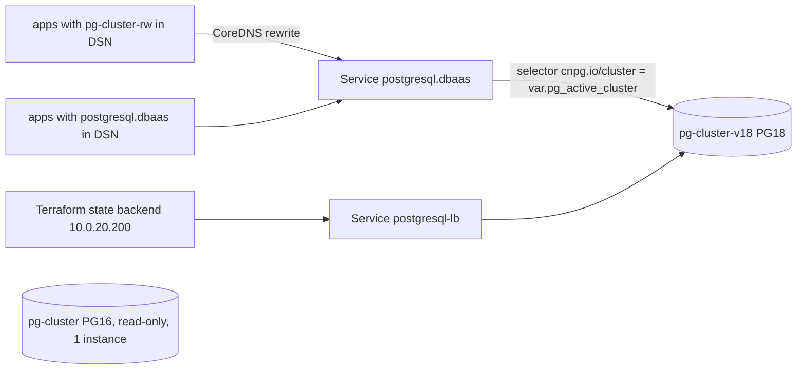

# pg-cluster major upgrade (blue-green) and rollback

Last updated: 2026-10-15 (PostgreSQL 16.9 to 18.6)

The shared CNPG cluster in `dbaas` moved from PostgreSQL 16 to 18 by building a
second cluster next to the first and switching consumers over, rather than
upgrading in place. The PG16 cluster stays as a read-only copy so a rollback is
a variable change, not a restore.

## Layout after the 2026-10-15 cutover

| Piece | Value |
|---|---|
| Active cluster | `pg-cluster-v18`: PG 18.6, PostGIS 3.6.4, pgvector 0.8.7, image `ghcr.io/viktorbarzin/cnpg-postgis-pgvector:18-pgvector0.8.7` |
| Rollback copy | `pg-cluster`: PG 16.9, one instance, `default_transaction_read_only=on`, data as of the cutover |
| The switch | `var.pg_active_cluster` in `stacks/dbaas/modules/dbaas/main.tf` |
| What follows the switch | the `postgresql` and `postgresql-lb` (10.0.20.200) Services, the `pg_*_db` provisioners, the backup CronJobs (host `postgresql.dbaas`) |
| `pg-cluster-rw` | CoreDNS (`stacks/technitium/modules/technitium/main.tf`, Corefile `.:53` block) answers `pg-cluster-rw.dbaas.svc.cluster.local` with the `postgresql` Service, so the roughly 40 consumers that have `pg-cluster-rw` in their DSNs follow the switch too |
| Superuser password | both clusters use the same one; `pg-cluster-v18` reads it from the `pg-superuser` secret, a copy of `pg-cluster-superuser` without owner references |
| Image source | `claude-memory-mcp` repo, `deploy/infra/Dockerfile.pgvector`, built by its `pgvector-image.yml` GitHub Actions workflow (manual dispatch) |

The `pg-cluster-ro` and `pg-cluster-r` Services still belong to the PG16
cluster; no consumer used them at the cutover. Use `pg-cluster-v18-ro` for
replica reads.

## Rollback to PG16

Writes made on PG18 after the cutover are not on the PG16 copy. Before rolling
back, dump anything written since then if it matters (`pg_dump` from
`pg-cluster-v18-1`).

1. In `stacks/dbaas/modules/dbaas/main.tf`:
   - `var.pg_active_cluster` default back to `"pg-cluster"`;
   - in `null_resource.pg_cluster`, set `default_transaction_read_only` to `"off"`
     (or remove it), set `instances` back to 3, and bump the `instances` and
     `pg_params` triggers so the manifest is re-applied;
   - the two backup CronJobs can stay on the `postgres:18.6-trixie` image
     (`pg_dump` 18 reads a PG16 server).
2. Make PG18 read-only so nothing writes to both: add
   `default_transaction_read_only: "on"` to `null_resource.pg_cluster_v18` and
   bump its `pg_params` trigger.
3. Apply `stacks/dbaas` from the main checkout (`../../scripts/tg apply`). It is
   a tier-0 stack, so the apply does not need the Postgres state backend.
4. Terminate client sessions on PG18 so apps reconnect through the Services:
   `kubectl -n dbaas exec pg-cluster-v18-1 -c postgres -- psql -U postgres -c "select pg_terminate_backend(pid) from pg_stat_activity where backend_type='client backend' and pid<>pg_backend_pid()"`.
5. Check: `kubectl -n dbaas get endpoints postgresql` lists the PG16 primary's
   IP, `show default_transaction_read_only` is `off` on `pg-cluster-1`, and the
   apps in "Proving it" below answer.

The CoreDNS rewrite stays in place in both directions; it always follows
`postgresql.dbaas`.

## How the copy was made

CNPG's `initdb.import` (monolith) restores with `--no-owner --no-privileges`,
which collapses object ownership and drops GRANTs, so it was not used. Instead:

1. `pg_dumpall --globals-only` from the PG16 primary, minus the
   `postgres`, `streaming_replica` and `app` roles that CNPG manages, applied
   with `psql` (only "role already exists" errors are expected).
2. Per database: `pg_dump -Fd -j 2` from the PG16 primary's pod IP, then
   `pg_restore --create -j 2` into PG18, then `ANALYZE`. The PG18 client tools
   in the new pod do both ends.
3. `GRANT CONNECT ON DATABASE postgres TO uptime_kuma_probe` (the `postgres`
   database is CNPG's and is not copied).

Timings on 2026-10-15: a sequential rehearsal while PG16 was live took 23
minutes (dawarich 377 s, technitium 368 s, health 99 s, woodpecker 78 s). The
final copy ran in three lanes (dawarich, technitium, the rest) and took 31
minutes, because the lanes competed for the same disks (dawarich alone took
1,833 s). Sequential is faster on this storage. The write window ran from
18:54 to 19:33 UTC.

## Freezing the old cluster: what the GUC does not stop

- `default_transaction_read_only=on` blocked every tenant except authentik,
  which kept writing to the frozen PG16 cluster (sessions, tasks, permissions).
  The row-count comparison caught it. Stop authentik's database access during
  the freeze by scaling `authentik/pgbouncer` to 0 and terminating its
  backends, copy authentik last, and scale pgbouncer back after the flip.
- Apps that refresh OAuth tokens during the window cannot save the new token.
  On 2026-10-15 Woodpecker refreshed viktor's Forgejo token at 19:10, could not
  store it, and then failed with `token was already used` until a fresh login
  at ci.viktorbarzin.me. Check `users.expiry` in the woodpecker database before
  a freeze and keep the window shorter than the time left.
- Vault's static-role rotations (for example `pg-terraform-state`, weekly) fail
  while the cluster is read-only and catch up afterwards. A rotation between
  the copy and the flip would land only on the old cluster, which is why the
  globals are copied again inside the window.
- While the old cluster keeps running, two pods carry
  `cnpg.io/instanceRole=primary`. Anything that picks a pod by that label alone
  can land on the frozen cluster and read stale data. On 2026-10-15
  `homelab k8s db` did exactly that, and the f1-stream viewing record looked
  empty from 18:11 UTC although every row was on PG18. Since CLI v0.27.2 the
  verb follows the `postgresql` Service's selector. Read the new cluster with
  `homelab k8s db` (or `kubectl exec pg-cluster-v18-1`) when comparing.

A comparison of the two clusters after the copy (database owners, extensions,
object counts per kind, table owners, table ACLs, sequence values, exact row
counts per table, roles and memberships) showed these expected differences:

- extension versions follow the new image (pgcrypto 1.4, pg_buffercache 1.6,
  vector 0.8.7, postgis 3.6.4);
- constraint counts are higher on PG18, which records NOT NULL constraints in
  `pg_constraint`;
- database ACLs that equalled the default (`=Tc/owner, owner=CTc/owner`) come
  back as the default (empty);
- SCRAM password hashes for `postgres` differ (same password, new salt).

## Next major

1. Build the image for the new major: bump `PG_MAJOR`, the base tag and
   `PGVECTOR_VERSION` in `deploy/infra/Dockerfile.pgvector` and the tag in
   `.github/workflows/pgvector-image.yml` (claude-memory-mcp), push to Forgejo,
   wait for the GitHub mirror, dispatch the workflow. CNPG publishes PostGIS
   bases only under full-minor tags such as `18.6-3.6.4-standard-trixie`.
2. Add a `pg-cluster-v<major>` resource next to the active one, copy, compare,
   freeze the old one, copy again, flip `var.pg_active_cluster`, as above.
3. Move the backup CronJob image and `PG_IMAGE` in `stacks/dbaas/verify.sh` to
   the new major in the same change; `pg_dump` refuses a newer server.

## Open items

- The PG16 cluster and its PVC (`pg-cluster-1`, 35Gi) are kept until Viktor
  decides to delete them. The two replica PVCs released by the scale-down keep
  their Proxmox volumes because the storage class reclaims with `Retain`.
- Immich runs its own Postgres (`immich-postgresql`, PG15 with VectorChord) and
  was not part of this upgrade. The `immich` database in pg-cluster had no
  connections at the cutover and was copied as-is.
