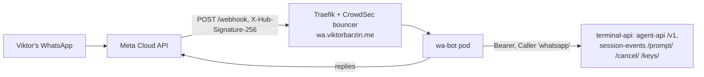

# wa-bot: WhatsApp access to Terminal Lobby

wa-bot lets Viktor drive his Terminal Lobby sessions from WhatsApp. He messages the
WhatsApp Cloud API test number (+1 555 671 2257) and the bot answers from the lab.

- Code: Forgejo `viktor/wa-bot` (Go). GitHub Actions builds `ghcr.io/viktorbarzin/wa-bot`
  (private), Woodpecker rolls the Deployment.
- Deploy: `stacks/wa-bot` (namespace, ExternalSecret, 1Gi state volume, ingress
  `wa.viktorbarzin.me`).
- Meta app: "HomeLab Messaging" (1498024285865316), WABA 2579571402516711,
  phone_number_id 1411075355419083, system user `wa-bot`.
- Lobby access: the `whatsapp` Caller (`devvm_external_agents` in `playbooks/devvm.yml`,
  token in Vault `secret/terminal-lobby` field `agent_api_whatsapp_token`).

## How a message is handled

1. The POST must carry a valid `X-Hub-Signature-256` (HMAC-SHA256 of the body with the
   app secret). Anything else gets 403 before the body is parsed.
2. Only `secret/viktor/contact` `contact_number` is answered; other senders get nothing.
3. A message id seen before (Meta retries for up to 7 days) or older than 30 minutes is
   dropped.
4. PIN: a message that starts with the PIN unlocks the bot for 30 minutes; inside the
   window no PIN is needed. Outside it, a message without the right PIN gets no reply
   and counts as a failure. Five failures in an hour lock the bot for an hour and post
   to #alerts. The PIN is stored only as an scrypt hash (`secret/wa-bot` `pin_hash`).
5. The command runs; the reply is plain text, at most 1,000 characters, with `more`
   for the rest, and secret-shaped strings are replaced by `[redacted]`.

## Threads

Each Lobby session is a thread inside the one chat. Session output starts with
`[<session>]`, the bot's own messages with `[bot]`, and the last message of a session
that has gone away with `[<session>] (ended)`.

The bot records which session every message it sends belongs to, for 30 days (the
period WhatsApp keeps quote context). Plain text goes to:

1. the session of the quoted message, when it is a reply;
2. the session named by `s <name> <text>` (one-shot, the current session stays);
3. the current session (set by `use`, `new` or the first `main`);
4. `main`, created when no session exists.

New sessions come only from `new`, `ask`, or a reply to an ended session's output,
which starts a session with the same name in the same directory and says so. An
unknown or expired quoted message falls back to the current session, with a note.

Sessions the bot started are driven through agent-api. Sessions started at the
keyboard are read through agent-api and steered through session-events (`/prompt/`,
`/cancel/`, `/keys/`, `/answer-text/`), which accept the Caller's bearer token
(checked 2026-10-21).

## Commands

| Command | Does |
|---|---|
| `ls` | numbered sessions; `*` marks the current one, `desk` a keyboard session |
| `use <name\|n>` | switch the current session |
| `<text>` | send to the routed session |
| `s <name\|n> <text>` | send once without switching |
| `new <name> [@repo] [text]` | new session in `~/code/infra` or `~/code/<repo>`, claude-opus-5, effort max |
| `ask <text>` | one-off question in a new `ask-N` session |
| `t [name\|n] [k]` | last k messages (default 3) |
| `st [name\|n]` | state, queue, last turn |
| `x [name\|n]` | stop the running turn |
| `a [name\|n] <n\|text>` | answer a waiting question |
| `more` | next page |
| `h` | help |

A leading `.` sends text that starts with a command word as plain text.

## Free tier

The Meta app has no payment method, deliberately. The bot counts 24-hour conversation
windows per calendar month (UTC) in its state file. At 80% of 1,000 it posts to
#alerts; at 1,000 it stops sending until the next month, and says so in #alerts once.

## Operating it

- Audit trail: `homelab logs query '{namespace="wa-bot"} |= "\"audit\":true"' --since 24h`.
  Every command, send, drop (sender, duplicate, stale, signature, locked) and reply is a
  JSON line; message text is not logged.
- State: `/data/state.json` on PVC `wa-bot-data`. Deleting it resets the PIN lockout,
  the quota count and the quote map.
- Lift a lockout early: restart the pod after clearing `locked_until` in the state file,
  or wait an hour.
- Revoke the bot's Lobby access: remove `whatsapp` from `devvm_external_agents` and run
  the playbook (or `scripts/agent-api-kill whatsapp`).
- The test number is registered with the Cloud API (`POST /{phone-number-id}/register`,
  2026-10-21). Its two-step PIN is `secret/wa-bot` `two_step_pin`; Meta asks for it if the
  number is ever re-registered. Before registration every send failed with
  `#133010 Account not registered`.
- Meta webhook subscription: app `whatsapp_business_account` object, callback
  `https://wa.viktorbarzin.me/webhook`, field `messages`, verify token
  `secret/wa-bot` `verify_token`; the WABA is subscribed to the app.

## Known limits

- The test number is Meta's sandbox; Meta may retire test numbers or cap recipients.
- Cloud API messages are decrypted on Meta's servers. The PIN guards a lost or borrowed
  phone, not Meta.
- The `whatsapp` Caller acts as `wizard` (sudo, cluster-admin, Vault), the same power
  Viktor accepted for Muse. agent-api has no scopes.
- Egress is locked (Calico policy `wa-bot-egress`, 2026-10-21): DNS on 10.96.0.10, Traefik,
  and TCP 443 to Meta's IPv4 ranges (from the CrowdSec `meta-asn.txt` list). Everything
  else is denied, including Slack, so lockout and quota alerts reach Loki only:
  `homelab logs query '{namespace="wa-bot"} |= "\"event\":\"alert\""'`.
