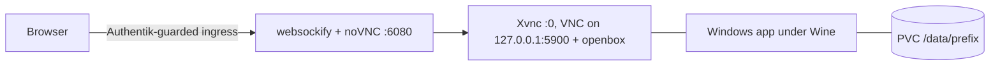

# wine-app

A generic image for running one Windows GUI application per pod under Wine,
viewed in the browser through noVNC. It is published publicly as
`ghcr.io/viktorbarzin/wine-app` and carries no application software: each app
is described by a few files mounted at `/app`, and the entrypoint downloads,
verifies and installs the app into a Wine prefix on the pod's volume on first
start.

The first app is Hikvision iVMS-4200 (`stacks/ivms/app/`). Paradox BabyWare is
the likely second.

## What is in the image

| component | version |
|---|---|
| base | `debian:bookworm-slim` |
| Wine | WineHQ stable `11.0.0.0~bookworm-1` (amd64 + i386), pinned |
| winetricks | release 20260125, pinned by commit `b76e1ee7` |
| fonts | Microsoft core fonts pre-fetched into the winetricks cache (no prefix in the image) |
| display | TigerVNC `Xvnc` and openbox (Debian packages), noVNC 1.6.0 from upstream pinned by sha256, websockify (Debian). Chosen by benchmark, ADR-0036 |
| tools | xdotool, xprintidle, imagemagick, osslsigncode, curl, procps, iproute2, tini |

It runs as uid 1000 (`app`), with `WINEPREFIX=/data/prefix`.

## App contract

The Terraform module mounts a ConfigMap read-only at `/app`:

| file | required | purpose |
|---|---|---|
| `app.env` | yes | shell variables, sourced with `set -a`, so every variable in it is also exported to Wine (e.g. `WINEPATH`) |
| `install.sh` | yes | the app's scripted GUI install. Called as `install.sh <installer>` with `DISPLAY` and `WINEPREFIX` set and no window manager running. Exit non-zero on any failure |
| `post-start.sh` | no | runs in the background once the app is launching, e.g. to dismiss a dialog the app shows on every start |
| `pre-stop.sh` | no | graceful app stop, run on SIGTERM (and after an install) before the generic Wine shutdown. Capped at 25 s |

`app.env` variables:

| variable | required | meaning |
|---|---|---|
| `APP_NAME` | yes | short name, used in the install marker |
| `APP_VERSION` | yes | the version the marker is keyed on; bump it to upgrade |
| `APP_INSTALLER_URL` | yes | where to download the installer. The file keeps its original name, since installers' windows are found by WM_CLASS, which is the lower-cased file name |
| `APP_INSTALLER_SHA256` | yes | hard gate: a mismatch stops the start |
| `APP_INSTALLER_REFERER` | no | sent as the HTTP Referer (Hikvision's CDN needs one) |
| `APP_LAUNCH` | yes | Windows path or command of the client |
| `APP_READY_WINDOW` | yes | `xdotool search --name` regex for the app's window, used by readiness |
| `APP_WINETRICKS` | no | space-separated winetricks verbs, e.g. `corefonts` |
| `APP_SERVICES_WAIT` | no | seconds to wait after `wineboot` before launching (default 0) |
| `SCREEN_GEOMETRY` | no | Xvnc screen as `WIDTHxHEIGHTxDEPTH`, default `1600x900x24` |

`/usr/local/bin/wine-app-lib.sh` has helpers for install scripts: find a window
by class and size, wait until it stops repainting, click at window-relative
coordinates and require the window to change, read a pixel, and on failure
print a screenshot as base64 into the log (`kubectl logs` then carries the
picture of what went wrong).

## Start sequence

1. Xvnc on `:0` with its VNC port on `127.0.0.1:5900` (no password, the
   ingress is guarded by Authentik), websockify serving noVNC on `0.0.0.0:6080`. The
   install can be watched through noVNC while it runs.
2. If `/data/.installed-$APP_NAME-$APP_VERSION` is missing, install (below),
   then re-exec the entrypoint so the first session runs from a clean boot.
3. openbox, a persistent `wineserver`, `wineboot`, then `APP_LAUNCH` in a loop
   that restarts the client 5 s after it exits (users close the window by
   accident). `post-start.sh` runs alongside.
4. A supervisor exits the container (so Kubernetes restarts it) if Xvnc,
   websockify, openbox, the idle loop, `wineserver` or `services.exe`
   dies.

## Install and upgrade

- **Fresh** (no `.installed-$APP_NAME-*` marker of any version): wipe
  `/data/prefix`, `wineboot -i`, winetricks verbs, `install.sh`. A half-finished
  install leaves no marker, so the next start wipes and retries.
- **Upgrade** (a marker for another version exists): keep the prefix and run
  the new installer over it, which is how Windows in-place upgrades work. The
  old marker is removed only after the new install succeeds, so a failed
  upgrade is retried over the same prefix on the next start.
- Download goes to `/data/.download/` and is reused on retry if its sha256
  matches; it is deleted after a successful install.
- Authenticode is checked with osslsigncode when the installer is a PE file.
  The result is logged and never fatal, so unsigned installers work; sha256 is
  the gate.

What an upgrade does to the app's data is app-specific; for iVMS see
`stacks/ivms/app/README.md`.

While installing, the pod is not Ready (see probes).

## Probes and idle signals

- `/usr/local/bin/app-ready` exits 0 only when noVNC answers on `:6080`, the
  entrypoint is past install, and a window matching `APP_READY_WINDOW` exists.
  Use it as the readiness probe. A liveness probe should be a plain TCP check
  on 6080 with a generous `initialDelaySeconds`, or none: the install takes
  5-10 minutes and the supervisor already exits on component death.
- `/tmp/last-viewer` is touched at startup and every 30 s while Xvnc on
  `:5900` has an ESTABLISHED client (each noVNC browser tab is one). Probes and
  Traefik keep-alives only reach `:6080`, so they do not count.
- `/tmp/input-idle-ms` holds the X server's input idle time in ms
  (`xprintidle`), refreshed every 30 s.
- `/tmp/wine-app-state` is `starting`, `installing`, `running` or `stopping`.

## Shutdown

On SIGTERM: stop the client restart loop, run `/app/pre-stop.sh` (25 s cap),
`wineboot --end-session --force --shutdown` (10 s cap), wait 5 s, then
`wineserver -k`. Measured 27-38 s for iVMS. tini runs without `-g`, so only the
entrypoint receives the signal and Wine processes are not all signalled at
once. Set `terminationGracePeriodSeconds: 60`.

A SIGTERM that arrives mid-install is handled when the current install step
returns; if the pod is killed first, the missing marker makes the next start
retry.

## Pod requirements

- `/data`: the PVC (RWO). It must be writable by uid 1000: set
  `securityContext.fsGroup: 1000` (Wine refuses a prefix directory it does not
  own; the entrypoint creates `/data/prefix` itself, so only `/data` needs to
  be group-writable). Size: iVMS uses about 3.2 GB of prefix plus 330 MB for
  the installer during install, so 10Gi leaves room.
- `/dev/shm`: a `medium: Memory` emptyDir (1Gi was used in testing; Docker's
  64 MB default is not enough for Wine and Qt apps).
- Not privileged, no extra capabilities, default seccomp (RuntimeDefault)
  worked under Docker. `runAsUser: 1000`, `runAsNonRoot: true`.
- `readOnlyRootFilesystem` is not supported: `/tmp`, `/home/app/.cache` and
  `/home/app/.config` are written.
- RLIMIT_NOFILE: the entrypoint lowers it to 65536 itself (some VNC servers
  stall on huge fd tables), nothing needed in the spec.
- Resources for iVMS: about 3.2 GB of memory at idle and 0.6-0.7 of a core
  (spike, 2026-10-17); request 3.5Gi, limit 5Gi.
- Ports: 6080 only. 5900 is bound to localhost.

## Adding a new app

1. Spike first: run the installer under this image by hand (an X display plus
   `import -window root` screenshots), find out which winetricks verbs it
   needs, whether it has a silent-install switch, which windows and dialogs it
   shows and their WM_CLASS and sizes (`wa_list_windows`), and whether the
   client starts its own background services.
2. Write `stacks/<app>/app/app.env` and `install.sh`. Prefer a silent switch
   when the installer honours one. Otherwise drive it with the helpers in
   `wine-app-lib.sh`: find windows by class and size, click relative to the
   window, require each click to change the screen, and assert files and
   registry entries at the end.
3. Add `pre-stop.sh` if the app keeps data open in background processes, and
   `post-start.sh` for dialogs that appear on every start.
4. Test locally: `docker run --shm-size=1g -v <vol>:/data -v $PWD/stacks/<app>/app:/app:ro -p 127.0.0.1:<port>:6080 ghcr.io/viktorbarzin/wine-app`,
   then a second container on the same volume, and check the app's data
   survived.
