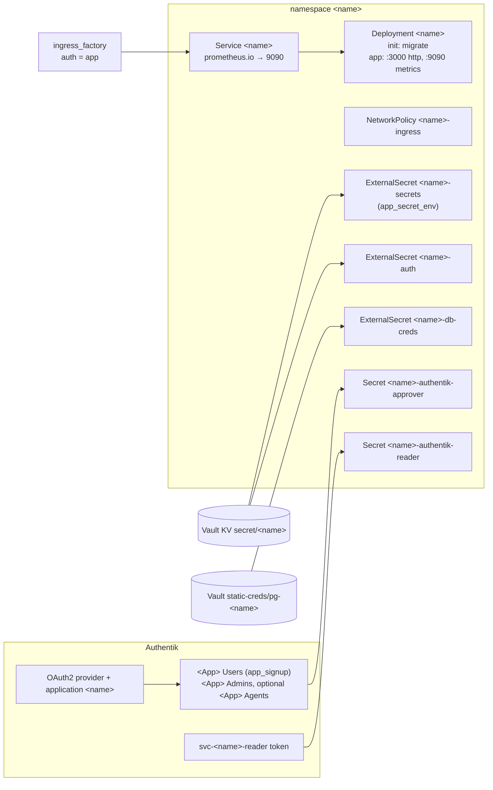

# tanstack_app

One first-party app on the default stack from ADR-0001
(`~/code/docs/adr/0001-default-app-stack.md`): TanStack Start on Bun, Drizzle
on the shared CNPG Postgres, sign-in through an Authentik OAuth2 application.
`stacks/tasks` is the first caller. The checklist for a new app is in
`docs/agents/new-app.md`.

## What it creates



| File | Resources |
|---|---|
| `main.tf` | namespace, Deployment (`migrate` init container + app container), Service, `module.ingress`, NetworkPolicy |
| `secrets.tf` | ExternalSecrets `<name>-secrets` (only when `app_secret_env` is set), `<name>-auth`, `<name>-db-creds`; Secrets `<name>-authentik-approver` (request mode) and `<name>-authentik-reader` |
| `authentik.tf` | OAuth2 provider and application, `module.signup` (`modules/authentik/app_signup`), admins and optional agents groups, policy bindings, the membership-reader service account and its token |

The module has no provider blocks. The calling stack configures kubernetes,
vault, cloudflare, kubectl (all generated by Terragrunt) and `authentik`:

```hcl
data "vault_kv_secret_v2" "authentik_tf" {
  mount = "secret"
  name  = "authentik"
}

provider "authentik" {
  url   = "https://authentik.viktorbarzin.me"
  token = data.vault_kv_secret_v2.authentik_tf.data["tf_api_token"]
}
```

## Usage

```hcl
module "app" {
  source = "../../modules/kubernetes/tanstack_app"

  name         = "myapp"
  display_name = "My App"
  tier         = local.tiers.aux

  image     = "ghcr.io/viktorbarzin/myapp"
  image_tag = var.image_tag

  postgresql_host = var.postgresql_host
  tls_secret_name = var.tls_secret_name

  admin_user_pks = [data.authentik_user.viktor.id]

  ingress = {
    homepage_description = "What the app does"
    homepage_icon        = "mdi-application"
  }
}
```

## Defaults and why

| Setting | Default | Reason |
|---|---|---|
| ingress `auth` | `"app"` (fixed) | The app runs its own OIDC sign-in and answers `/api` with 401 without a session or bearer token. Forward-auth would break the bearer-token API and the OAuth callback. |
| rate limit | ingress_factory default | Its real-ip plugin sets `X-Real-Ip`, which Better Auth's rate limiter keys on. |
| `ingress.custom_content_security_policy` | `frame-ancestors 'none'` | The default csp-headers middleware lets any `*.viktorbarzin.me` page frame the app. |
| `ingress.extra_middlewares` | `traefik-strip-auth-headers@kubernetescrd` | No public route may carry a client-sent `X-authentik-*` identity. |
| `ingress.anti_ai_scraping` | `false` | Every page past the sign-in wall needs a session, so there is nothing to mine, and the bot-block forwardAuth would sit on every API call. |
| `ingress.turnstile` | `false` | Installed PWAs run in a standalone webview, and a Turnstile pass is tied to the network that solved it, so a phone changing networks would meet the challenge page mid-session. |
| `strategy` | `Recreate` | One realtime LISTEN connection and one writer during a rollout. |
| `replicas` | `1` | Each pod uses 5 connections of the shared Postgres (pool 4 + LISTEN 1), plus 1 for the `migrate` init container while it runs. |
| `signup_mode` | `request` | New accounts wait for an admin to approve them in the app. |
| `access_token_validity` | `minutes=15` | ADR-0001: removing someone from a group takes effect within 15 minutes. |
| `grant_types` | `["authorization_code"]` | Authentik 2026.x creates a provider with an empty list otherwise, which refuses every authorize request. No `offline_access`, no refresh tokens. |
| `bind_home_server_admins` | `true` | As for every other app here. |

Lifecycle markers on the Deployment: `RELOADER_LIFECYCLE_V1`,
`KYVERNO_LIFECYCLE_V1` (dns_config; the namespace ignores the goldilocks
label), and `CI_SETS_IMAGE` on both the app container and the `migrate` init
container. `image_tag` matters only when the Deployment is (re)created; the
app's Woodpecker deploy sets the running tag on both containers.

The reloader annotation lists `<name>-secrets`, `<name>-auth`, the approver
and the reader Secret, and leaves `<name>-db-creds` out: the app reads the
password file on every new connection, so a Vault rotation needs no restart.

## Env contract

The app container gets, in this order:

| Source | Variables |
|---|---|
| `<name>-secrets` | one per `app_secret_env` entry |
| `<name>-auth` | `BETTER_AUTH_SECRET`, `OIDC_CLIENT_ID`, `OIDC_CLIENT_SECRET` |
| `<name>-authentik-approver` | `AUTHENTIK_APPROVER_TOKEN`, `AUTHENTIK_USERS_GROUP_ID` (request mode) |
| `<name>-authentik-reader` | `AUTHENTIK_READER_TOKEN` |
| env | `DATABASE_URL` (no password), `DATABASE_PASSWORD_FILE=/secrets/db/password`, `NODE_ENV=production`, `PUBLIC_ORIGINS` (`https://<host>` first, then `extra_public_origins`), `OIDC_DISCOVERY_URL`, `AUTHENTIK_API_URL` |
| env, when `emit_group_env` | `AUTH_USERS_GROUP`, `AUTH_ADMINS_GROUP`, `AUTH_AGENTS_GROUP` (when `agents_group` is set) |
| env | `extra_env`, in list order |

The `migrate` init container gets `DATABASE_URL` and `DATABASE_PASSWORD_FILE`
and runs `entrypoints/migrate.js`. `DEV_USER` is never set.

## Prerequisites per app

- Vault KV `secret/<name>` with `better_auth_secret`, `oidc_client_id`
  (= `<name>`), `oidc_client_secret`, and any `app_secret_env` properties.
  CI's Vault role can read but not write `secret/*`, so these are seeded by
  hand.
- An `app_databases` entry in `stacks/dbaas/modules/dbaas/app_databases.tf`.
- A `pg_app_roles` entry in `stacks/vault/app_db_roles.tf`.

## Outputs

`namespace`, `deployment_name`, `service_name`, `host`, `public_origins`,
`client_id`, `application_slug`, `issuer_url`, `discovery_url`,
`users_group_id`, `users_group_name`, `admins_group_id`, `agents_group_id`
(null without agents), `approver_username` (null in open mode).

## Open questions

- The reader service account holds `view_group` only on `<App> Users`.
  Whether Authentik still returns the admins group in the user's groups, so an
  admin re-check keeps `admin = true`, has not been checked live yet.
