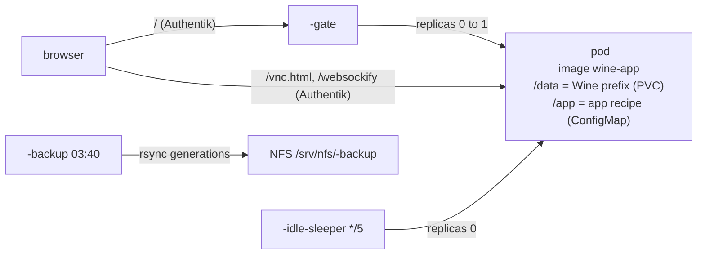

# wine_app — a Windows app under Wine, in the browser, asleep when idle

One module call runs one Windows desktop app in its own pod: Wine, an X
display, and noVNC at `https://<host>.viktorbarzin.me` behind Authentik. The
pod sleeps at 0 replicas and wakes on visit. Decision record: ADR-0035. First
user: `stacks/ivms` (iVMS-4200).

## What a call creates

| Resource | Notes |
|---|---|
| PVC `<name>-prefix` | `proxmox-lvm-encrypted`, autoresized to `storage_limit`. Holds the whole Wine prefix: the installed app, its database, its settings |
| ConfigMap `<name>-app` | `var.app_files`, mounted read-only at `/app` |
| Deployment `<name>` | `replicas = 0`, owned by the gate and the sleeper (`ignore_changes`). Recreate. uid 1000. Memory-backed `/dev/shm`. Ready only when `app-ready` passes |
| Gate `<name>-gate` | `gate.py` (stdlib, tested by `test_gate.py`). `/` wakes and redirects to noVNC; `/status`, `/wake` answer JSON |
| CronJob `<name>-idle-sleeper` | every 5 min: sleeps the app after `idle_no_viewer_seconds` (1800) with no viewer, or `idle_no_input_seconds` (7200) with no keyboard or mouse input. Any read error leaves it running |
| CronJob `<name>-backup` | daily hardlinked rsync of the prefix to `/srv/nfs/<name>-backup`, 14 generations |
| Ingresses | gate on `/`, noVNC paths to the pod, both `auth = "required"` with `allowed_groups` |

The calling stack owns the namespace (tier label) and any network policy the
app needs. The `wine-app` Deployment label scopes the `WineAppWakeFailed` and
`WineAppStuckAwake` alerts (stacks/monitoring).

## The app recipe

`app_files` must contain `app.env` and `install.sh`. The contract, with an
example, is in `images/wine-app/README.md`. In short: `app.env` names the
installer (URL, sha256, optional Referer), the version, the launch command and
the main window title; `install.sh` drives the installer on the virtual X display with
xdotool. On start the image installs the app into `/data/prefix` if the marker
for that version is missing. Bumping the version in `app.env` runs the new
installer over the existing prefix on the next start.

## Adding an app

1. Spike it first: install it under Wine in a container on the devvm, the way
   iVMS was (memory #15883), and check the features that matter work. Apps
   that fail are decided one by one (ADR-0035).
2. Create the NFS backup directory on the PVE host:
   `ssh root@192.168.1.127 'mkdir -p /srv/nfs/<name>-backup'`
   (`docs/runbooks/nfs-prerequisites.md`).
3. New stack: namespace with a tier that fits the memory (3-edge allows an
   8Gi container, 4-aux caps at 4Gi), `setup_tls_secret`, the module call, and
   the app's `app/` directory. Copy `stacks/ivms` as the starting point.
4. Apply, open the URL, and watch the first-start install in the pod log.

## Operating

- Wake from a script: `curl -s https://<host>.viktorbarzin.me/wake` needs an
  Authentik session; from inside the cluster, port-forward the gate Service.
- See the screen without Authentik (debugging):
  `kubectl -n <ns> port-forward deploy/<name> 6080` then
  `http://127.0.0.1:6080/vnc.html`.
- Reinstall from scratch: scale to 0, delete the PVC, apply (a new empty PVC),
  open the URL. The app's own data is gone; restore it from the backup first.
- Restore: scale to 0, mount the PVC in a throwaway pod with the NFS backup,
  `rsync -a --delete /backup/<generation>/ /data/`, scale up.
